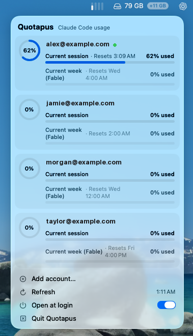

# Quotapus

A tiny macOS menu bar app that shows how much of your Claude Code usage limit each of your Claude accounts has used. Handy when you switch between several accounts and keep losing track of which one still has room.

<p align="center">
  
</p>

- One small bar per account in the menu bar, filled by how much is used. It turns **orange** from 75% and **red** from 90%.
- Hover for every account's percentage. Click for a native glass panel with the details.
- Add as many accounts as you like. They stay after you switch accounts in Claude Code.

## What the panel shows

For each account, the same numbers as Claude Code's `/usage`:

- A ring with the tightest limit that applies now.
- **Current session** and **Current week** bars, each with "% used" and when it resets.
- A green dot next to the account Claude Code is signed in to right now.

Below the accounts: **Add account…**, **Refresh** (with the time of the last update), **Open at login** and **Quit**.

## Adding accounts

Two ways, use either:

1. **Add account…** in the panel. A Claude sign-in page opens in Chrome (or your default browser), you approve, and the account appears. It adds whichever account that browser is signed in to on claude.ai, so switch accounts there first to add the next one.
2. **Sign in in Claude Code.** Quotapus notices the account Claude Code is signed in to (checked every 30 seconds, on your Mac only) and adds it. Run `/login` with each account once.

To remove an account, hover over its card and click the ×.

## How it works

- Usage comes from the same Anthropic endpoint Claude Code's `/usage` reads (`api.anthropic.com/api/oauth/usage`).
- Sign-in uses Claude Code's own OAuth flow (PKCE, a one-time `localhost` callback) and asks only for `user:profile`. Quotapus never runs Claude with your accounts.
- Each account's login is kept in the macOS Keychain under the service `Quotapus`. Claude Code's own login is only read, never changed.
- Quotapus never renews the login Claude Code is using, because renewing a login another app holds can sign that app out. If Claude Code hasn't been opened for about 8 hours, that one account asks you to open Claude Code.

### How often it calls Claude

Per account:

| What | How often |
|---|---|
| Read usage | Every 15 minutes, and when you open the panel if the numbers are older than 5 minutes |
| Renew the login | Only when the 8-hour login is about to expire, about 3 times a day |
| Identify the Claude Code login | Once each time that login changes |

After an error (rate limited, server error, offline), that account is left alone for 30 minutes. A signed-out account gets no more calls until you add it again. Every call is logged, one line each, in `~/Library/Logs/Quotapus.log`.

Quotapus reads usage the way Claude Code itself does, with about the traffic of one open Claude Code window per account. It is not made by or affiliated with Anthropic.

## Install

Needs macOS 26 and the Xcode command line tools (`xcode-select --install`).

```sh
git clone https://github.com/datasadeqist/Quotapus.git
cd Quotapus
make install
```

This builds a universal app (Apple silicon and Intel), copies it to `~/Applications/Quotapus.app` and opens it. Turn on **Open at login** in the panel to keep it running.

The build is signed ad hoc, so macOS asks once after each rebuild before Quotapus can read the logins it saved. To avoid that, sign with your own certificate:

```sh
make install SIGN="Apple Development: Your Name (TEAMID)"
```

## Uninstall

Turn off **Open at login** first, then:

```sh
make uninstall
```

This removes the app, its settings and the logins it saved. Claude Code's login is not touched.

## License

MIT
